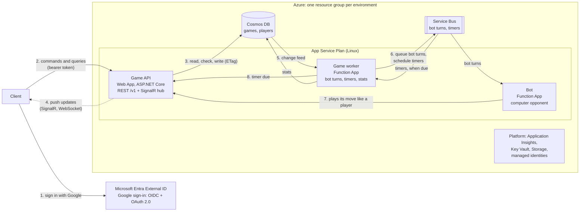
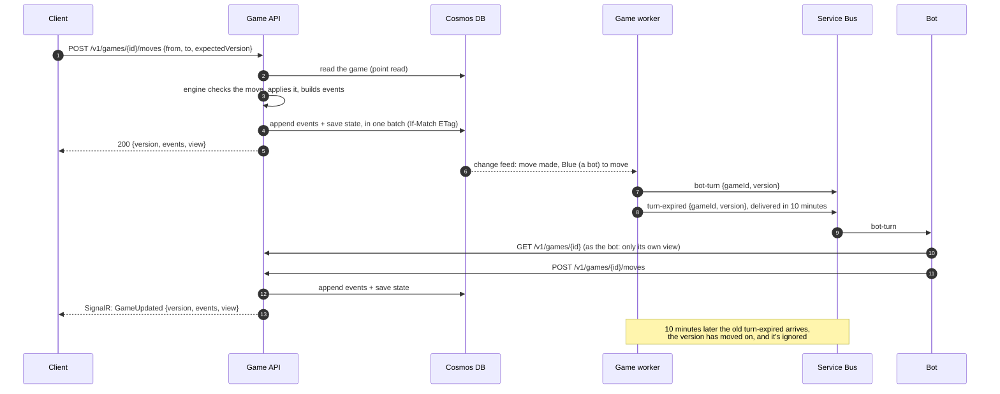
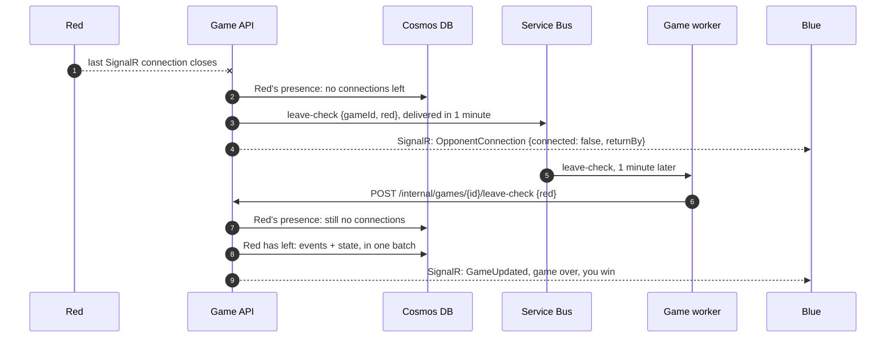

# Architecture

How the Stratego Barrage API is built: the back end that players' clients play through. We build the API to match this document, and update it whenever a design decision changes. The rules the API enforces are in [RULES.md](RULES.md).

## 1. Goals

What the API is for:

- **Multiplayer.** Every game is played through the API, against the computer or against a friend.
- **Live games.** Both players are online for the whole game.
- **Everyone registers.** There's no guest play, and every player has a profile with their stats.
- **Online only.** There's no offline mode. Clients don't run the rules or the computer opponent; the API does.

How it's built:

- **Long-lived.** This is the real back end, not a prototype.
- **Server-authoritative.** Stratego is a game of hidden information, so the server holds the full game and only ever sends each player what they're allowed to see.
- **Distributed.** The API, the worker and the bot are separate apps that work through queues and a shared database, and each can run on more instances without code changes.
- **Delivered continuously,** to a test and a production environment.
- **Cheap while traffic is low.**

## 2. Overview



**The API is the only thing that changes a game or talks to players over SignalR.** The bot and the worker ask it to, over HTTP, like any other caller.

**One move against the computer:**



Against a friend it's the same, minus the bot: the API pushes `GameUpdated` to the opponent after each move.

**A player leaves:**



If Red reconnects within the minute, the check finds a connection and nothing happens.

## 3. How it's built

### 3.1 The server owns the game; clients are viewers

- The API holds the full `GameState` and runs the engine. Clients only ever receive their own `PlayerView`.
- Every view comes with that player's **legal moves**, so a client needs no rules to highlight squares, and client and server can never disagree on the rules.
- **Two kinds of events.** Stored events are complete (a setup event holds every rank). Events sent to a player are filtered for them, and never include a rank that's still hidden.
- **The JSON contract uses the engine's own shapes:** `PlayerView` for what a player sees, `GameEvent` for what happened (so a client can animate it), and `Move`.

### 3.2 Live games

- **10 minutes per move.** Each player has 10 minutes for each move, or they forfeit the game. Placing the setup gets the same 10 minutes: a player who hasn't placed their pieces in time forfeits, and if neither has, the game is cancelled. The computer is held to the same limit, though it moves in about a second.
- **The server keeps the time.** When a turn starts, the game records its `turnDeadline`, and the worker schedules a `turn-expired` message for that moment. When it arrives, the worker passes it to the API, and if the game's version hasn't moved on, the player to move forfeits.
- **Clients show the countdown themselves.** Every view carries the `turnDeadline` and the server's current time (`serverTime`), so a client can correct for its own clock being off and count down locally, every second, without any messages. Each `GameUpdated` over SignalR carries the next deadline, and when time runs out, the `GameUpdated` that ends the game arrives the same way. The client never decides a timeout itself: the server does.
- **Leaving forfeits, after a minute.** When a player's last connection to the game closes, their opponent is told, and the player has 1 minute to come back. A dropped connection that comes back in time changes nothing. After a minute away, they've left the game and lose.
- **Resigning** ends the game straight away.
- **No saved games.** A game can't be paused or picked up later. When it ends, its result goes into each player's profile.

### 3.3 Playing a friend: invite links

- A player starts a game against a person and gets an invite link to send: the client's address (a setting) with the game id and an invite code. The code is random (128 bits), so the link can't be guessed, and it works once.
- The friend opens the link, signs in (which registers them if it's their first time) and joins. **Sides are drawn at random**; Red moves first. Then both place their pieces.
- **While the game waits for the friend,** its status is `waiting`. If the player who created it cancels, or leaves (the same 1-minute rule), the game is cancelled. It never started, so it doesn't count in anyone's stats.
- A player can't join their own game, and a link that's been used can't be used again.

### 3.4 Language: .NET 10

- Everything is .NET 10 (the current LTS release): the API is ASP.NET Core, and the worker and the bot are Azure Functions in the isolated worker model.
- **The engine and the computer opponent are written in C#.** The engine has table-driven tests: a case for each rule in [RULES.md](RULES.md), including every way a game ends.
- **One games module** holds the engine, the commands (start, join, place setup, move, resign, leave, time out) and their storage. The API runs every command through it.
- **One solution,** `StrategoBarrage.slnx`:

  | Project | What it is |
  | --- | --- |
  | `src/StrategoBarrage.Api` | The Game API |
  | `src/StrategoBarrage.Worker` | The game worker's Function App |
  | `src/StrategoBarrage.Bot` | The bot's Function App |
  | `src/StrategoBarrage.Games` | The games module |
  | `src/StrategoBarrage.ServiceDefaults` | What all three apps share: telemetry and health checks |
  | `src/StrategoBarrage.AppHost` | The Aspire app host, for local development (section 3.16) |
  | `tests/StrategoBarrage.Games.Tests` | Unit tests for the games module |
  | `tests/StrategoBarrage.Api.Tests` | Integration tests: the apps together, through the app host |

- **Tests** use xUnit v3, with Shouldly for assertions.

### 3.5 REST and SignalR

- **REST** for everything a client asks or tells the server, described by an OpenAPI document that's generated from the code at build time and used to generate clients.
- **Commands go over HTTP, updates come over SignalR.** A move is a `POST`, not a hub call. The hub only pushes updates, and tracks who's connected.
- **Every update carries the game's version.** A client that misses a push sees the gap and fetches what it missed. SignalR is a speed-up, never the only way to learn about a move.

### 3.6 Hosting and scaling: Azure App Service

- **One Linux App Service Plan per environment,** with three apps on it:

  | App | Kind | Runs |
  | --- | --- | --- |
  | Game API | Web App | ASP.NET Core: the REST API and the SignalR hub, with WebSockets enabled |
  | Game worker | Function App | A Cosmos DB trigger on the change feed, and a Service Bus trigger on `game-timers` |
  | Bot | Function App | A Service Bus trigger on `bot-turns` |

- **Always On** is enabled on all three, so the API never idles and the Functions' triggers keep running.
- **Plans:** test runs on one B1 instance, and production on one Premium v3 (P0v3) instance.
- **When the instance restarts** (a platform update, say), players' connections drop and reconnect within seconds. The 1-minute leave rule means nobody loses a game over it.
- **Scaling out is adding instances to the plan.** Every app runs on every instance, so the API, the worker and the bot grow together. They're built for it:
  - **API requests** are load-balanced across all instances, and no instance holds a game.
  - **Service Bus triggers** compete for messages: each bot turn and each timer is handled once, by whichever instance takes it.
  - **The Cosmos DB trigger** splits the change feed into leases, one per partition range, and each lease is read by one instance at a time. If that instance is lost, another takes over its leases.
- **Releases: blue-green for the API.** In production, the new API deploys to a staging slot, warms up, and is swapped in, so no HTTP request fails. The old version stays in the staging slot, and swapping back is the rollback.
  - **SignalR:** players' connections are held by the API process, so after a swap they drop and reconnect to the new version within seconds.
  - **Shared data:** both versions use the same database and queues, so each release must work with documents and messages written by the one before it, and the one after it if we roll back.
- **The Function Apps deploy in place.** A restart only pauses them for a moment, and they carry on from where they stopped, because the change feed position and the queued messages are kept outside the app.

### 3.7 Database: Cosmos DB for NoSQL

- **A game is one partition.** Its current state, its events and its players' presence live together. A command is a point read plus one transactional batch: the events are appended and the state is replaced, atomically, guarded by the state's ETag.
- **The change feed drives everything after a write.** Every committed event appears on it, in order per game, and the worker acts on it (section 3.9), so nothing is ever saved without its follow-up happening too.
- **The free tier** (1,000 RU/s and 25 GB, one account per subscription) goes to production; test uses serverless.
- **One database, with its throughput shared by all the containers.** Production's 1,000 RU/s is set on the database, not on each container. Throughput set per container needs at least 400 RU/s each, so four containers would need 1,600 RU/s, more than the free tier covers.

### 3.8 Sign-in: Google, through Microsoft Entra External ID

- **OIDC and OAuth 2.0 together.** OIDC signs the player in (an ID token says who they are). OAuth 2.0 lets the app call the API (an access token with the API's scopes). Clients use the authorization code flow with PKCE (MSAL), and the API validates JWT bearer tokens.
- **Entra External ID** is Microsoft's sign-in service for customer apps, with Google as its only sign-in option. It issues the players' access tokens.
- **Registering is signing in for the first time.** The player signs in with their Google account, External ID creates their account, and the API creates the player profile on the first call to `/v1/me`, with their name and picture from Google. External ID may show one page of its own on the way; we check whether it can go straight to Google when we build sign-in.
- **Every player call needs a signed-in player.** There are no anonymous endpoints apart from health checks.
- **Our own player id.** The API maps a token's issuer and subject to an internal `playerId`, so the rest of the system never sees provider ids.
- **Authorization is ours.** Who may move in which game is decided by the API, not the identity provider.
- **SignalR** gets the same access token when connecting, and the hub requires it. Each player's connections are grouped under their `playerId`, so the server can send an update to one player.
- **The Function Apps sign in as themselves.** The bot and the worker each have their own managed identity, and call the API with its token. Those tokens come from the Azure subscription's own Entra ID tenant, not from External ID, so the API trusts two issuers.
- **App roles tell the Function Apps apart.** The API has an app registration in the subscription's tenant as well, with two app roles: `Bot`, assigned to the bot's identity, and `Worker`, assigned to the worker's. A `Bot` token is accepted on the game endpoints as its bot player; a `Worker` token only on the `/internal` endpoints.

### 3.9 Background work and messaging

- **The worker's Cosmos DB trigger** checks the change feed for new changes every 500 ms (the trigger's default is 5 seconds), so the bot replies within its target (section 8). It reads the changes and:
  - queues a `bot-turn` when the next move belongs to the bot;
  - schedules a `turn-expired` message for each turn's deadline;
  - updates both players' stats and finished games when a game ends.
- **The worker's Service Bus trigger** handles timers when they're due (`turn-expired` and `leave-check`), by passing each to the API's `/internal` endpoints.
- **Service Bus** (Basic tier, which has the queues and scheduled messages we use), two queues:
  - `bot-turns`, which the bot reads;
  - `game-timers`, for scheduled messages: turn deadlines (from the worker) and leave checks (from the API's hub).
- **Delivery is at least once**, so every consumer is idempotent, keyed by game and version.

### 3.10 Real time: SignalR in the API

- **The hub runs inside the API** and holds players' connections itself, over WebSockets. There's no separate SignalR resource, in test or production.
- **Presence:** when a player's connection to a game opens or closes, the hub records it in the game's partition (a presence item per player), so the leave check doesn't depend on which instance held the connection. When the last one closes, it tells the opponent and schedules the leave check.
- **With a second instance, Azure SignalR Service (Standard) is turned on.** A player's connection would be on one instance while their opponent's move lands on another; the service holds every connection in one place, so any instance can reach any player. The API uses the service whenever its connection setting is present.

### 3.11 The bot

- **A bot is a player.** It gets a `bot-turn` message, fetches its own `PlayerView` from the API, chooses a move and submits it through the same endpoint as a person. The computer can't cheat, because the server never shows it more than a player would see.
- **Its own Function App,** with its own identity, so it can only ever act as the bot.
- **The bot** plays by rules of thumb. It places its setup as soon as the game is created.

### 3.12 Concurrency and idempotency

- **Each game has a version:** the number of events so far. Every command sends the version it was based on (`expectedVersion`), and the write is guarded by the state's ETag.
- **Two commands racing** (a move and its turn running out, say): one wins; the other gets `409 Conflict` with the current view.
- **A retried move** that already went through also gets `409`, and the client finds its move in the events. Moves need no separate idempotency key.
- **Consistency:** a game's own view is always current (read from its partition). Profiles and stats are updated a moment after a game ends.

### 3.13 Versioning

- **Major version in the URL** (`/v1`). Within a version, changes are only additive.
- **A breaking change** means `/v2` running beside `/v1` until clients have moved over.
- **Errors** use Problem Details (RFC 9457).

### 3.14 Security

- **No secrets in config:** each app reaches Cosmos DB, Service Bus, Storage and Key Vault with its own managed identity and Azure RBAC.
- **Every move is checked on the server.** Hidden ranks and random seeds never leave it until the rules reveal them.
- **Rate limits** per player and per IP, with ASP.NET Core's rate limiter.
- **CORS** allows only the client origins set in configuration.

### 3.15 Observability

- **OpenTelemetry** traces, metrics and logs go to Application Insights from all three apps. Trace context travels through Service Bus, so one move is one trace across API, worker and bot.
- **Telemetry from both environments together stays within the free monthly allowance,** because Application Insights charges for every GB beyond it:
  - **Sampling:** at most 5 traces a second are recorded, each with its logs. While traffic is low every request is recorded; under load, the rate caps what's sent.
  - **A daily cap on each environment,** with the two caps adding up to less than the allowance. Production's is above normal use, so it only stops runaway logging. Test's is below it, so test's telemetry stops partway through each day.
  - **No performance counters:** CPU and memory come from the App Service Plan's platform metrics, which cost nothing.
  - **Noise is filtered out:** health-check pings and SignalR keep-alive messages aren't recorded.
- **Health checks:** the API has a health endpoint, and App Service's health check takes a failing instance out of rotation.
- **Game metrics:** games started and finished, how they ended (including resigning, leaving and running out of time), move latency, bot thinking time, connected players, and rejected moves, which are also a sign of cheating attempts.

### 3.16 Local development

- An **Aspire** app host starts the API and the two Function Apps with emulators for Cosmos DB and Service Bus, and shows their traces and logs in one dashboard. The emulators need Docker Desktop.
- Locally the API accepts tokens from a development issuer, so the tests and a client running locally work without the real sign-in.

## 4. Data model

Cosmos DB containers. Ids are UUIDv7, so they sort by creation time.

| Container | Partition key | Holds |
| --- | --- | --- |
| `games` | `/gameId` | Each game's state, its events, and its players' presence |
| `players` | `/playerId` | Each player's profile, and a record of each finished game |
| `logins` | `/id` | Which player a sign-in (issuer and subject) belongs to |
| `leases` | `/id` | The worker's change feed position |

How they're used:

| Access | When | How |
| --- | --- | --- |
| Load a game, apply a command, save it | Every setup, move, resignation and timeout | Point read, then a transactional batch in the game's partition |
| A game's events since a version | Catching up after a missed push | Query within the game's partition |
| A player's presence | Connecting, disconnecting, leave checks | Point read and write in the game's partition |
| Profile and stats | `GET /v1/me` | Point read in the player's partition |
| Finished games | `GET /v1/me/games` | Query within the player's partition, newest first |
| Player for a sign-in | First request of a session | Point read in `logins` |

**`games`:** three kinds of item in each game's partition.

```jsonc
// The game: its current state, server-only. Replaced on every command.
{
  "id": "0192f3c4-…", "gameId": "0192f3c4-…", "type": "game",
  "mode": "vs-bot",                // vs-bot | vs-person
  "status": "playing",             // waiting | setup | playing | over | cancelled
  "players": {
    "red":  { "playerId": "0192f3a1-…", "kind": "human" },
    "blue": { "playerId": "bot/rules-of-thumb", "kind": "bot" }
  },
  "invite": null,                  // { "code": "…", "createdBy": "0192f3a1-…" } while a vs-person game is waiting
  "version": 37,                   // events so far
  "state": { },                    // the engine's full GameState, every rank included
  "turnDeadline": "2026-10-17T14:19:40Z",
  "result": null,                  // { winner, reason } once it's over; reason: flag | no-moves | draw | resigned | left | timed-out
  "createdAt": "2026-10-17T14:02:11Z",
  "startedAt": "2026-10-17T14:03:05Z",   // both setups placed, first move allowed
  "endedAt": null,
  "updatedAt": "2026-10-17T14:09:40Z",
  "schemaVersion": 1
}

// One per thing that happened. Append-only.
{
  "id": "0192f3c4-…:000037", "gameId": "0192f3c4-…", "type": "event",
  "seq": 37, "kind": "move-made", "by": "red",
  "data": { "from": { "row": 6, "col": 4 }, "to": { "row": 5, "col": 4 } },
  "at": "2026-10-17T14:09:40Z"
}

// One per person in the game: their open connections. Not an event, so it doesn't change the version.
{
  "id": "0192f3c4-…:presence:red", "gameId": "0192f3c4-…", "type": "presence",
  "side": "red", "connections": ["k2Jf…"], "lastDisconnectedAt": null
}
```

**`players`:** the profile, plus one record per finished game, both kept up to date by the worker.

```jsonc
// The profile. Stats are split by opponent, because beating the computer and beating a person aren't the same.
{
  "id": "0192f3a1-…", "playerId": "0192f3a1-…", "type": "profile",
  "displayName": "Player One", "avatarUrl": "…",     // from Google at registration
  "stats": {
    "vsComputer": { "played": 12, "won": 9, "lost": 3, "drawn": 0, "secondsPlayed": 5400 },
    "vsPeople":   { "played": 4,  "won": 1, "lost": 3, "drawn": 0, "secondsPlayed": 2100 }
  },
  "createdAt": "…"
}

// One per finished game.
{
  "id": "0192f3c4-…", "playerId": "0192f3a1-…", "type": "finished-game",
  "mode": "vs-person", "side": "blue", "opponent": { "kind": "human", "playerId": "…", "name": "Player Two" },
  "result": "won", "reason": "flag",
  "moves": 37, "startedAt": "…", "endedAt": "…", "durationSeconds": 395
}
```

- **How long a game took** is from the first move allowed (`startedAt`) to the end (`endedAt`).
- **Every finished game counts:** a game lost by resigning, leaving or running out of time is a loss, and a win for the opponent. Cancelled games don't count.
- **Only what's queried is indexed.** The game's `state` and each event's `data` are left out of Cosmos DB's index. Nothing queries inside them, and it makes every write cheaper.
- **Stats come from events, not counters bumped by hand.** The worker updates them from the change feed when a game ends, keyed by game, so a retry never counts a game twice.
- **Documents carry a `schemaVersion`** and are upgraded when read. Cosmos DB has no schema migrations to run.

## 5. API

| Method | Path | What it does |
| --- | --- | --- |
| `GET` | `/v1/me` | Your profile and stats; registers you on first sign-in |
| `GET` | `/v1/me/games` | Your finished games: opponent, result, length (paged) |
| `POST` | `/v1/games` | Start a game against the computer: `{ "mode": "vs-bot" }` |
| `GET` | `/v1/games/{id}` | Your view: the board as you see it, your legal moves, the version, the turn deadline and the server's time |
| `GET` | `/v1/games/{id}/events?after={version}` | What happened since a version, as you're allowed to see it |
| `PUT` | `/v1/games/{id}/setup` | Place your 8 pieces |
| `POST` | `/v1/games/{id}/moves` | Play a move: `{ from, to, expectedVersion }` |
| `POST` | `/v1/games/{id}/resign` | Resign |
| `POST` | `/v1/games` | Start a game against a friend: `{ "mode": "vs-person" }`, which returns the invite link |
| `POST` | `/v1/games/{id}/join` | Join a friend's game: `{ "code": "…" }` |
| `DELETE` | `/v1/games/{id}` | Cancel your game while it's waiting for your friend |

**Responses:** `401` without a valid token, `403` for a game you're not in, `409` when `expectedVersion` is stale (with the current view) or an invite has been used, `422` for a move the rules don't allow (Problem Details saying why).

**Internal endpoints,** for the worker only:

| Method | Path | What it does |
| --- | --- | --- |
| `POST` | `/internal/games/{id}/turn-expired` | `{ version }`: the player to move forfeits, if the game is still at that version |
| `POST` | `/internal/games/{id}/leave-check` | `{ side }`: that player has left, if they still have no connection |

**Hub** at `/hubs/games`:

| Direction | Message | When |
| --- | --- | --- |
| Client → server | `EnterGame(gameId)` | Opening a game; the connection now counts as being in it |
| Server → client | `GameUpdated { gameId, version, events, view }` | After every change, filtered for each player |
| Server → client | `OpponentConnection { gameId, connected, returnBy }` | Your opponent's connection dropped (and when they'll have left), or came back |

## 6. Delivery

- **Trunk-based,** with `main` protected, squash merges and CI on every PR: build, format check, tests, a check that the committed OpenAPI document matches the code, and the breaking-change check (oasdiff, against the last release's document).
- **Test on merge.** A merge to `main` builds the three apps with `dotnet publish`, applies the infrastructure, deploys them to test, and checks the API's health endpoint.
- **Production on release.** Publishing a GitHub Release with a `v*` tag on `main` rebuilds that commit and deploys it to production, after approval.
- **One SDK version.** `global.json` names the .NET SDK, and CI, test and production all build with it. A new SDK reaches production only after it's been through test.
- **Dependencies stay current.** Dependabot opens PRs every week for NuGet packages, the .NET SDK and GitHub Actions, but only for releases at least 2 weeks old, so a broken or compromised release has time to be caught. Fixes for known vulnerabilities come as soon as they're found.
  - **NuGet:** minor and patch updates come in one PR, and each major update in its own. The Aspire packages share a version, so they always come together in one PR.
  - **Versioned with .NET:** the SDK, `Microsoft.AspNetCore.*` and `Microsoft.Extensions.*` get no major updates: those come with moving to a new .NET version.
  - **GitHub Actions:** all updates come in one PR.
- **Infrastructure in Bicep** (`infra/`), applied on every deployment, with a one-time bootstrap for the resource groups and the GitHub Actions identities.
- **Per environment:** an App Service Plan with the API Web App and the two Function Apps, a storage account for the Function Apps, a Cosmos DB account, a Service Bus namespace, a Key Vault, Application Insights, and a managed identity for each app.
- **Region:** Central US.

## 7. Cost and capacity

Estimates from Azure's list prices for Central US. The capacity is worked out from what a move costs in request units.

### Monthly cost

| Resource | Test | Production |
| --- | --- | --- |
| App Service Plan | B1: about $13 | P0v3: about $62 |
| SignalR | Inside the API: $0 | Inside the API: $0 |
| Service Bus | Basic: cents, billed per operation | Basic: cents, billed per operation |
| Cosmos DB | Serverless: about $2, mostly the worker checking the change feed | Free tier: $0 |
| Application Insights, Storage, Key Vault | A few dollars at most | A few dollars at most |
| Entra External ID | Free up to 50,000 monthly active users | Free up to 50,000 monthly active users |
| **Total** | **About $17** | **About $65** |

### Players at once

**Production handles about 200 players at once, and Cosmos DB is the bottleneck.**

| Part | Its limit | Players at once |
| --- | --- | --- |
| Cosmos DB, 1,000 RU/s | About 40 moves a second, at about 25 RU a move | **About 200** |
| App Service, one P0v3 instance (the API and its SignalR connections) | A move takes a few milliseconds of CPU, and mostly waits on Cosmos DB; a connection takes a few KB of memory | Several thousand |
| Service Bus, worker, bot | Very little work per move | Not a limit |

- **The assumption:** each player moves about every 5 seconds on average, and in games against the computer the bot's moves count too.
- **Past Cosmos DB's limit,** nothing fails at once. Cosmos DB asks the API to wait (HTTP 429), the SDK retries, and moves get slower. If the load stays above the limit, requests start to fail.

### Growing

**Azure Monitor alerts fire at 80% of each limit:** Cosmos DB's normalized RU consumption, and the plan's CPU and memory. When one fires:

| When | What to change | Extra a month |
| --- | --- | --- |
| Up to about 200 players | Nothing | $0 |
| About 200 to 1,000 players | Raise Cosmos DB's throughput by about 100 RU/s for every 20 players, up to about 5,000 RU/s | Up to about $230 |
| The plan's CPU or memory stays high | Turn on Azure SignalR Service (Standard), then add a plan instance | About $49 for SignalR, $62 per instance |
| More than 1,000 players connected through Azure SignalR Service | Add a SignalR unit for every 1,000 players | About $49 per unit |

Each change is a setting in the Bicep, deployed like any other change. None of them needs a code change.

## 8. Service levels

The targets the API is held to. Every change has to keep them.

- **These are our own targets (SLOs), not an SLA.** We make no contractual promise to players.
- **They apply to production.** Test's timings don't reflect production's; CI's budgets cover every change before it gets there.
- **Measured over a rolling 30 days,** from OpenTelemetry metrics and the events' timestamps, not from traces. Traces are sampled and metrics aren't, so the numbers are exact.

### Targets

| What | Measured as | Target |
| --- | --- | --- |
| Availability | Requests not answered with a 5xx. A `409` or `422` is an answer, not a failure | 99.9% |
| Making a move | The API's time for `POST /v1/games/{id}/moves` | 95% within 100 ms, 99% within 300 ms |
| Reading a game | The API's time for `GET /v1/games/{id}` and `GET /v1/games/{id}/events` | 95% within 50 ms, 99% within 200 ms |
| Every other endpoint | The API's time | 95% within 200 ms |
| Pushes | From a change being saved to its `GameUpdated` being sent | 95% within 100 ms |
| The bot's reply | From the player's move being saved to the bot's move being saved | 95% within 2 s, 99% within 5 s |
| Timers | From a turn deadline or leave check falling due to the game ending | 99% within 10 s |
| Stats | From a game ending to both players' profiles being updated | 99% within 1 minute |

- **99.9% is as high as the platform allows.** A move needs App Service (99.95% in its SLA) and Cosmos DB (99.99% in one region), which together give 99.94%, on one instance that restarts for platform updates.
- **A move has room to spare.** It's one point read and one batch write, each under 10 ms in Cosmos DB's SLA, plus a few milliseconds in the engine.

### Error budget

- **0.1% of a month's requests may fail.** That's about 43 minutes of full outage.
- **Alerts fire when the budget is spent fast:** when one hour uses 2% of the month's budget, or six hours use 5%. A latency target missed over an hour fires an alert too.
- **When a month's budget is spent,** only fixes ship to production until the API is back within its targets.

### Holding changes to the targets

- **Budgets in CI, on every PR.** They give the same result on every run, so they never fail by chance:
  - **Request units per command.** Integration tests against the Cosmos DB emulator check what each command costs, and a move may cost at most 30 RU. Section 7's capacity rests on about 25 RU a move.
  - **The bot's thinking time.** A test plays the bot on the hardest positions in its tests, and fails if any move takes longer than 250 ms.
- **A release that breaks a target is rolled back** (section 3.6).

## 9. Open questions

None right now.
